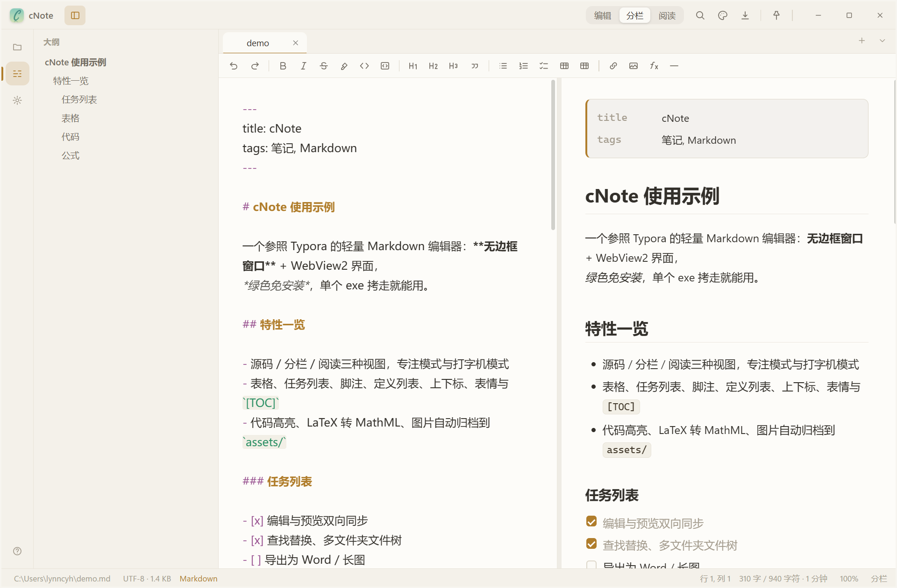
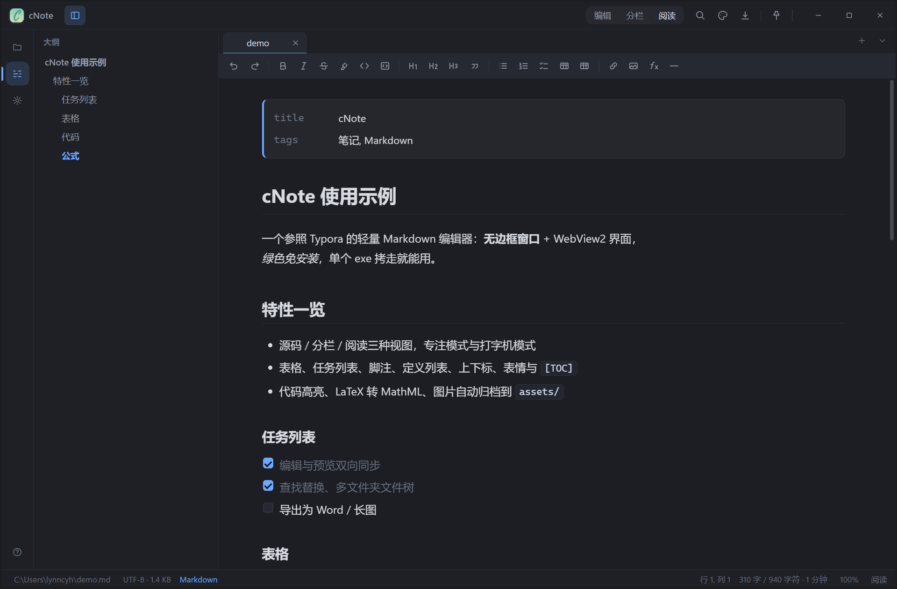

<p align="center">
  
</p>

<h1 align="center">cNote</h1>

<p align="center">
  轻量 Markdown 笔记编辑器<br>
  <sub>Windows 10 1803+ · 单个 exe 约 0.4 MB · 免安装 · 中文界面</sub>
</p>



## 特性

- 源码 / 分栏 / 阅读三种视图，专注模式、打字机模式，8 套主题
- 表格、任务列表、脚注、定义列表、上下标、表情、YAML front matter、`[TOC]`
- 代码高亮与 LaTeX→MathML 都用自带实现，不打包 KaTeX 之类的库
- 图片粘贴或拖入自动存到文档同级的 `assets/`
- 多文件夹文件树、搜索、回收站删除、外部改动检测、会话恢复
- 查找替换、导出 HTML / PDF / Word / 长图、复制为富文本
- 大文档不卡：编辑器按行绘制，预览按块虚拟化



*阅读模式 · 夜幕主题*

## 下载与运行

当前版本 **0.1**。取 [`release/cNote.exe`](release/cNote.exe) 双击即可，
另需 [Microsoft Edge WebView2 Runtime](https://developer.microsoft.com/microsoft-edge/webview2/)
（Windows 11 自带，Windows 10 装了新版 Edge 通常也有）。

系统要求、快捷键、配置与数据文件的位置、卸载方式都在
[release/README.md](release/README.md)（应用内按 `F1` 也能看到全部快捷键）。

## 从源码构建

需要 Visual Studio 生成工具（`cl.exe`、`link.exe`）和 Windows SDK。
构建脚本不依赖 `vcvars64.bat`，会自己找工具链（`..\vs`、`..\sdk` 优先）。

```powershell
npm install --prefix tools esbuild   # 可选：装了之后前端会被去掉注释并压小
.\tools\build-msvc.ps1
```

产物是 `build-msvc\cNote.exe`，`-Debug` 参数换成 `/Od /Zi` 并保留调试信息。
打包方式和体积明细（前端 minify → deflate 内嵌，注释不进产物）见
[工程笔记](doc/engineering-notes.md)。

## 目录

| 路径 | 内容 |
| --- | --- |
| `src/` | C++ 宿主：窗口、WebView2、命令桥、文件、剪贴板、导出 |
| `assets/` | 前端：编辑器、Markdown 渲染、代码高亮、数学、主题 |
| `tools/` | 构建、资源打包与压缩脚本 |
| `release/` | 发布拷贝：`cNote.exe` + [使用说明](release/README.md) |
| `doc/` | [工程笔记](doc/engineering-notes.md)：性能数据与实现取舍 |

## 致谢

交互参照 [Typora](https://typora.io/)；视口渲染模型来自
[CodeMirror System Guide](https://codemirror.net/docs/guide/)；块级规则按首字符分派
借鉴 [markdown-it](https://github.com/markdown-it/markdown-it)；分栏同步的映射方式
与 [VS Code 的 Markdown 预览](https://github.com/microsoft/vscode) 同思路；
解析器以 [CommonMark](https://commonmark.org/) 官方测试套件为准。

## 许可

[MIT License](LICENSE)。
